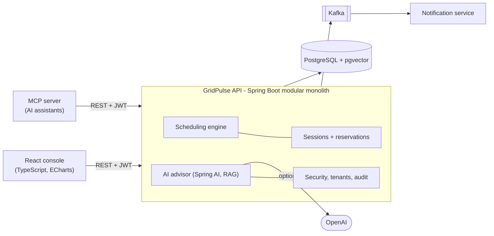

# GridPulse AI

[](https://github.com/lavanesh-tech/gridpulse-ai/actions/workflows/ci.yml)

**Overnight charging planner for electric delivery fleets.** It decides which van charges on which charger and when,
so that every vehicle leaves in the morning with enough battery, without overloading the depot's grid connection,
while charging at the cheapest hours possible.

Built end to end by me as a portfolio project: a Java 21 / Spring Boot backend, a React console, an AI advisor
grounded in the depot's own documents, Kafka events, and a CI pipeline that tests all of it on every push.

---

## The problem

A depot has more vans than fast chargers, a hard limit on how much power it can draw, electricity that costs several
times more in the evening than after midnight, and vans that must leave at fixed times. Plugging vans in as they
arrive ("first come, first served") wastes cheap night hours and lets urgent vehicles miss their departure.

## What GridPulse does

- **Plans the night.** A priority-and-deadline scheduler places each charging session in 15-minute slots, respecting
  charger connectors, charger and vehicle power limits, the grid capacity, and existing bookings.
- **Proves every plan is valid.** An independent validator re-checks every schedule; a plan with a single violated
  constraint is never shown as feasible.
- **Shows the trade-offs.** One screen compares three strategies (first come first served, deadlines first,
  cheapest first) on the same vehicles: who leaves on time, who is left short and why, and what it costs.
- **Re-plans after problems.** "What if charger A1 fails at 1 a.m.?" returns a new plan from that moment and names the
  vehicles that would now miss their departure.
- **Answers questions with sources.** The AI Energy Advisor answers from the depot's tariff and policy documents (RAG),
  cites the passages it used, and refuses when the documents do not cover the question.
- **Stops double-booking at the database level.** Overlapping reservations are rejected by PostgreSQL exclusion
  constraints and row locks, which holds even under concurrent requests (and is tested that way).

## Results (measured, on synthetic data)

Over 40 seeded scenarios with 50,000 vehicle-nights in total ([method and raw output](BENCHMARKS.md)):

| | First come, first served | GridPulse (deadlines first) | GridPulse (cheapest first) |
|---|---|---|---|
| Vehicles leaving on time | 96.7% | **97.1%** | 96.1% |
| Urgent vehicles on time | 96.4% | **99.6%** | 99.6% |
| Average energy price | 0.234 / kWh | 0.162 (**−30%**) | 0.113 (**−52%**) |
| Constraint violations | 0 | 0 | 0 |

The honest part: prioritising urgent vans costs the lowest-priority ones (96.9% → 93.5% on time), and the cheapest
strategy meets slightly fewer deadlines. GridPulse shows these trade-offs instead of hiding them.

Other measurements: planning a 100-vehicle, 20-charger depot takes **18 ms at p95** under a 60-second load test
(k6, 0% errors, on a laptop). With OpenAI embeddings the advisor finds the right document in the top 3 for
**14 of 14** test questions (MRR 0.95), against 13 of 14 for the offline keyword fallback.

> All data is synthetic, and the tariff is invented. These numbers compare algorithms against each other; they are not
> claims about any real fleet.

## How it is built



- **Modular monolith, on purpose.** One deployable with enforced module boundaries (Spring Modulith tests fail the
  build if a module reaches into another's internals). One service, notifications, is extracted because it has a
  different job and can fail independently. The reasoning is in [DECISIONS.md](DECISIONS.md).
- **Multi-tenant and secure by default.** Every request carries a JWT; the tenant always comes from the token, never
  from the request, so one company cannot see another's data (tests check that you get a 404, not someone else's
  record). Four roles, rate limiting, an audit log of every change, and RFC 9457 error responses.
- **Events that cannot be lost.** Session changes are written to an outbox table in the same database transaction,
  then relayed to Kafka. The consumer is idempotent and sends unreadable messages to a dead-letter topic.
- **AI that is kept honest.** The model never decides a schedule. It explains plans computed by the Java engine, can
  only call read-only tools, and its citations are checked against what was actually retrieved.
- **Observable.** Health probes, Prometheus metrics for the scheduler, advisor and HTTP traffic, and a request id on
  every log line.

## Tech stack

| Area | Technologies |
|---|---|
| Backend | Java 21, Spring Boot 3.5, Spring Modulith, Spring Data JPA, Spring JDBC, Hibernate, Flyway, Gradle |
| Data | PostgreSQL 16 with pgvector (HNSW index), Redis |
| Security | Spring Security, OAuth2 resource server, JWT, role-based access, multi-tenancy |
| AI | Spring AI, OpenAI (gpt-4o-mini, text-embedding-3-small), RAG, tool calling, MCP server |
| Messaging | Apache Kafka (KRaft), transactional outbox, idempotent consumer, dead-letter topic |
| Frontend | React 19, TypeScript, Vite, Tailwind CSS, TanStack Query, ECharts |
| Testing | JUnit 5, Testcontainers (real Postgres and Kafka), Vitest, Testing Library, Playwright, k6 |
| DevOps | Docker (multi-stage, non-root), Docker Compose, GitHub Actions, Jenkinsfile, Micrometer/Prometheus |

More than **120 automated tests** run on every push: 103 backend tests across the three services, 19 frontend tests, and
5 browser tests against a real running stack. A coverage gate fails the build below 80% (currently 82%).

## Try it

You need Docker Desktop and JDK 21.

```bash
git clone https://github.com/lavanesh-tech/gridpulse-ai.git && cd gridpulse-ai
cp .env.example .env              # set GRIDPULSE_JWT_SECRET (openssl rand -base64 48) and GRIDPULSE_ADMIN_PASSWORD
./scripts/stack.sh                # builds and starts everything in Docker
python3 scripts/seed-demo.py      # adds a demo depot: 2 stations, 8 chargers, 12 vans, tonight's bookings
```

Open http://localhost:3000, sign in as `admin` with the password from `.env`, and try **Plan charging → Show plan**,
**Simulate failure**, and the **Advisor**. Stop with `./scripts/stack.sh down`.

The advisor works without an AI key (it returns the most relevant passages). To get written answers, run
`./scripts/setup-openai.sh`, which stores the key only in the git-ignored `.env`.

<details>
<summary>More commands (tests, benchmarks, development, MCP)</summary>

```bash
./scripts/verify.sh          # all backend + frontend tests, coverage gate, Docker smoke test
./scripts/e2e.sh             # Playwright browser tests against a throwaway stack
./scripts/load-test.sh       # k6 load test (runs in Docker)
./gradlew benchmark          # scheduler benchmark -> benchmarks/results/
./scripts/evaluate-openai.sh # retrieval quality with OpenAI embeddings

./scripts/run-local.sh                         # API on :8080 with Kafka events
./scripts/run-notifications.sh                 # notification service on :8081
cd frontend && npm install && npm run dev      # console on :5173 with hot reload
```

**MCP server.** `mcp-server/` lets an AI assistant such as Claude Desktop use GridPulse's read-only tools
(`listFleets`, `listVehicles`, `planTonight`, `compareStrategies`, `askDepotDocuments`). It signs in as a normal user,
so the same tenant and role checks apply. Build with `./gradlew :mcp-server:bootJar` and add to
`claude_desktop_config.json`:

```json
{ "mcpServers": { "gridpulse": {
    "command": "java",
    "args": ["-jar", "/path/to/gridpulse-ai/mcp-server/build/libs/mcp-server-0.1.0-SNAPSHOT.jar"],
    "env": { "GRIDPULSE_API_URL": "http://localhost:8080", "GRIDPULSE_USERNAME": "<viewer user>", "GRIDPULSE_PASSWORD": "<password>" }
} } }
```

API docs: http://localhost:8080/swagger-ui.html when the API runs. Health: `/actuator/health`.
</details>

## Documentation

| | |
|---|---|
| [ARCHITECTURE.md](ARCHITECTURE.md) | Modules, data model, security, events, delivery |
| [DECISIONS.md](DECISIONS.md) | 29 architecture decisions and the reasons behind them |
| [BENCHMARKS.md](BENCHMARKS.md) | How every number above was measured, including the ones that looked bad at first |
| [API_DOCUMENTATION.md](API_DOCUMENTATION.md) | REST API reference |
| [PRODUCT_SPEC.md](PRODUCT_SPEC.md) | Requirements and hard constraints |
| [LEARNING_GUIDE.md](LEARNING_GUIDE.md) | Plain-language notes on each concept used, from JWT to Kafka |
| [ROADMAP.md](ROADMAP.md) | The nine milestones the project was built in |

## What I would do next

- Deploy to AWS (ECS, RDS, Amazon Bedrock as a second model provider) with Terraform.
- Feed real charger telemetry (OCPP) instead of planned sessions.
- Replace the greedy scheduler with a MILP solver for small depots and compare both on the same benchmark.

## Author

**Lavanesh Thirukonda Mahendran** · MS Computer Science, George Mason University
[GitHub](https://github.com/lavanesh-tech)
